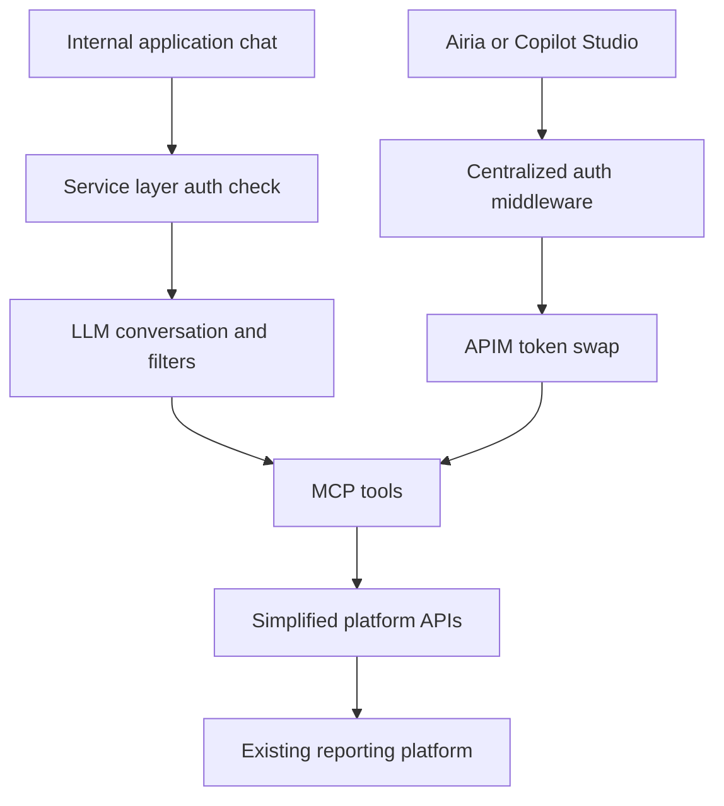
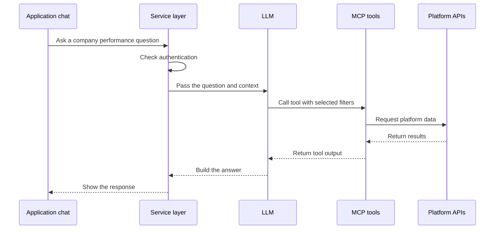
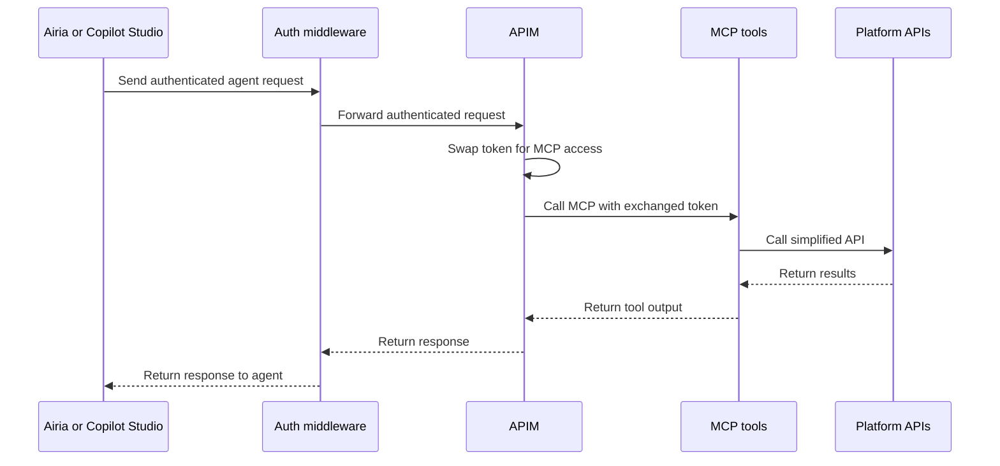

# AI analysis and agent access for a reporting platform

Ali Awais | Project presentation for EnOcean

I worked on an AI layer over our existing data reporting platform. It helped business users ask questions about company performance and compare data across companies. It also gave other teams a shared way to connect their AI agents to the same platform.

We built an MCP layer, simplified the APIs behind it and added an AI analysis chatbot. External agents connected through our centralized authentication middleware and Azure API Management (APIM), where we performed a token swap before calling MCP.

The result was around 8 hours saved per week for our business users. We measured this by comparing the time they spent building manual reports around the same data.

## Why we built it

The reporting platform already held financials, ESG, digital, innovation and other asset specific non financial data. The data was there. Getting a useful view across it still took manual work.

Reports were scattered across multiple places. Users had no consolidated view where they could compare different companies or build an analysis around a question that came up during their work. The BI layer had a fixed set of charts and comparison options.

Other teams wanted to build AI agents around the same data. Our APIs were protected and giving agents direct access would have introduced risk. We needed a shared integration layer with a clear authentication path.

Business owners also depended on technical teams for operational changes. These included extending submission dates or closing a submission manually. We collected these cases alongside the reporting and analysis needs when defining the tools the MCP layer would expose.

## What we built

| Part | Purpose |
| --- | --- |
| AI analysis chatbot | Let internal users ask questions and build company comparisons through a conversation. |
| MCP layer | Expose the required platform operations as tools that AI clients could call. |
| Simplified APIs | Give those tools a focused interface to the existing reporting platform. |
| Internal service layer | Check authentication before handling requests from the application. |
| Centralized auth middleware | Handle the authentication path for external agents. |
| APIM token swap | Exchange the incoming token for the token used to call MCP. |
| Airia and Copilot Studio integration | Let other teams use the same tools from their orchestration platforms. |

I worked on this as part of a team. This presentation describes the solution we built and the decisions behind it. It is an architecture walkthrough, not a copy of the internal source repository.

## How it works

There were two entry points. Internal users worked through the application chat. External agents worked through an orchestration platform. Both used the MCP layer to reach the reporting platform.

### Internal application chat

The user asks a question in the application. The service layer checks authentication. The LLM handles the conversation and works out the filters needed for the request. The MCP layer calls the relevant tools. The results go back to the LLM to form the response shown to the user.

For example, a user could ask, “Compare the financial performance of Company A and Company B for the same reporting period.” The company names here are examples. This is not a recorded production query.

The important part is that the model works with data returned by the tools. The reporting platform remains the source of the figures used in the comparison.

### External AI agents

Teams using Airia or Copilot Studio could consume the tools through a separate authentication path. Their requests went through our centralized auth middleware and then APIM. APIM performed the token swap before calling MCP.

This gave teams a shared integration path without making each agent responsible for direct access to the existing protected APIs. The exact token grant, claims and APIM policy are not included in this presentation.

## Decisions and tradeoffs

We added the AI layer over the existing reporting platform. This let us build around data and workflows that were already in use. It also meant the quality of an answer still depended on the quality and availability of the underlying data.

We used MCP as the common tool interface. Internal chat and external orchestration platforms could use the same platform capabilities. This added another layer to maintain, but it gave us one place to define the tools instead of building a separate integration for every agent.

We introduced simplified APIs behind the tools. This kept the tool interface focused on business tasks. Changes to the underlying platform still needed to be reflected in those APIs and tool contracts.

We kept authentication in the service and gateway path. The LLM handled conversation and tool selection. Access to protected systems belonged in application infrastructure.

Operational changes need more care than analysis requests. Extending a submission date or closing a submission changes business state. A walkthrough of those tools should cover permission checks, user confirmation and audit history separately. This presentation does not claim that every collected operational use case was released or describe controls that have not been documented here.

## Results and evaluation

The project saved our business users around **8 hours a week**. We evaluated this by comparing the time they previously spent preparing manual reports with the time needed to build reports around the same data using the new flow.

This is a workflow time saving. It is not a model accuracy score. The figure is not presented as a per user saving because the measurement scope has not been broken down here.

For a deeper evaluation, I would keep a fixed set of comparison questions and check each response against the source data. I would also test missing data, incompatible units, different reporting periods and requests outside the caller's access. For operational tools, I would test failed requests and repeated calls before treating the workflow as complete. These are proposed checks, not reported test results.

## Why this project fits EnOcean

The strongest connection is the work of turning existing business data into useful AI workflows. We connected tools through APIs, reduced recurring manual work and built a shared layer that other teams could use for their agents.

The project also involved the people who owned the process. Their reporting needs and operational dependencies shaped the use cases. The goal was to make their existing work easier and measure the time saved.

EnOcean works with sensor and operational data. This project used company reporting data. It demonstrates AI integration, tool orchestration and workflow design. It does not demonstrate training sensor models or developing energy harvesting hardware.

**The main lesson for me was that a useful AI workflow needs more than a chat interface. It needs usable data, clear tool contracts and an access path that fits the existing system. Building those parts made the same platform useful to both business users and other AI teams.**
